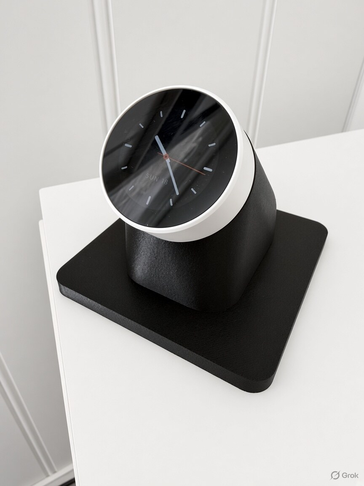
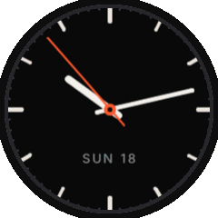
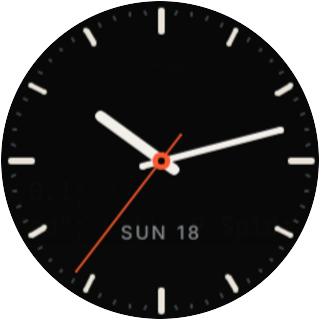
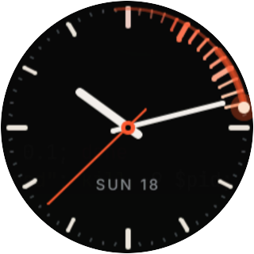
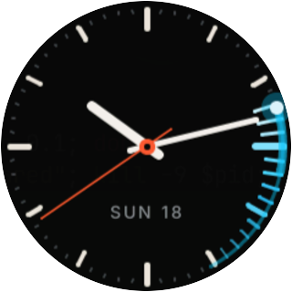
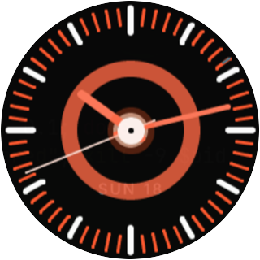
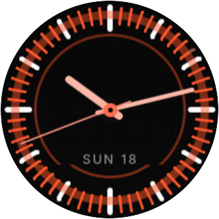
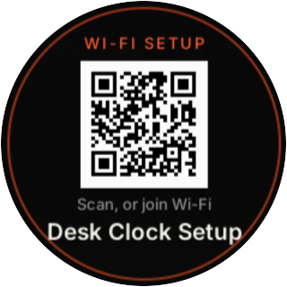
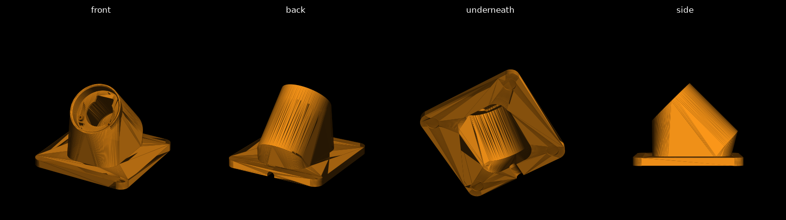

# Nextion Desk Clock

An analog desk clock for Home Assistant, running ESPHome on the **Open Nextion ONX2424G013**
round knob display. It keeps time and shows the date, and its dial and button become Home
Assistant controls for anything you like: dim the lights, change the volume, run a scene.

<p align="center">
  
  
</p>
<p align="center"><sub>Left: concept render, AI-generated with Grok. It's not a photo of the actual build;
the real stand's shape is in the <a href="#desk-stand">desk stand renders</a>. Right: the
firmware's animations, captured from the simulator.</sub></p>

<p align="center">
  
  
  
  
  
</p>

## Features

- **A clean analog face**: hour bars, minute dots, smooth-sweeping (or ticking, or no) second
  hand, and the date. Time comes from Home Assistant, with internet time as a fallback.
- **Knob animations**: turning the dial sends a comet round the bezel, ember orange
  clockwise and cyan anticlockwise, with a tail that stretches the faster you spin. A press
  fires a white-hot shockwave that flares the whole bezel. Runs at about 30 fps on the device.
- **Home Assistant controls**: button presses (single, double, long) and dial turns as
  entities and events for your automations. The screen is a light entity with on/off and brightness.
- **Easy setup for anyone**: with no Wi-Fi, the clock shows a QR code for its setup hotspot.
  Then it asks to be added in Home Assistant, which creates and installs the encryption key
  itself. There's nothing to copy and paste.
- **3D-printable mounts**: a desk stand that tilts the face 45° towards you, and an
  Australian-size wall plate.

## Hardware

- **Open Nextion ONX2424G013**: ESP32-S3 (16 MB flash, 8 MB PSRAM), 1.28" 240×240
  GC9A01 round screen, rotary encoder with push button, USB-C.
- **For the desk stand**: 2 × M1.6 × 6 mm screws, 4 × 10 mm stick-on rubber feet, and a
  USB-C cable with a straight plug no longer than 45 mm.

## Getting started

### 1. Flash the firmware

**The easy way:** download `desk-clock-<version>.factory.bin` from the
[latest release](../../releases/latest), plug the knob in over USB, open
[web.esphome.io](https://web.esphome.io) in Chrome or Edge, click **Connect**, then **Install**
and choose the file.

**Or build it yourself** with [ESPHome](https://esphome.io) 2026.7 or newer:

```sh
cd firmware
esphome run desk-clock-share.yaml --device /dev/ttyACM0
```

### 2. Connect it to Wi-Fi

With no Wi-Fi saved, the clock opens a hotspot called **Desk Clock Setup** and shows a QR
code. Scan it with your phone to join, and the setup page opens: pick your Wi-Fi and enter
the password. (If the page doesn't open by itself, browse to any website.) You can also set
the Wi-Fi over USB at [web.esphome.io](https://web.esphome.io).

<p align="center">
  
  
</p>

If the saved Wi-Fi can't be reached for a minute, the hotspot comes back, so the clock can be
set up again somewhere new.

### 3. Add it to Home Assistant

Once it's on Wi-Fi, the screen says **Add me in Home Assistant**. Go to
**Settings → Devices & services**, find **Desk Clock** under *Discovered*, and click **Add**.
Home Assistant generates the encryption key and installs it on the clock, so you won't be
asked for one. The setup screen disappears with a shockwave, and the clock is ready.

To use the batched dial event (below), open the device's ESPHome options in Home Assistant
and tick **Allow the device to perform Home Assistant actions**.

## Home Assistant entities

| Entity | What it does |
|---|---|
| `light.desk_clock_display` | Screen on/off and brightness |
| `event.desk_clock_button` | `single_press`, `double_press`, `long_press` |
| `binary_sensor.desk_clock_button` | Raw pressed / released, instantly |
| `event.desk_clock_dial` | `clockwise` / `anticlockwise`, once per click |
| HA event `esphome.desk_clock_dial` | `steps`: dial movement over the last 200 ms, 2 per click, positive = clockwise |
| Second hand | Smooth, Tick or Off |
| Face rotation | 0°, 90°, 180° or 270°, to suit how the knob is mounted (90° for the desk stand) |
| Show date / Knob feedback | Turn the date and the knob animations on or off |

A single press arrives about 0.3 s after you let go, because the clock waits to see whether
it's a double press. For an instant response, use the raw `binary_sensor` instead.

The dial is relative: it reports which way it turned, never a position, so it always works
from the controlled entity's current state. Use the batched `esphome.desk_clock_dial` event
for brightness and volume: a fast spin then makes a few big changes instead of queueing dozens
of small ones.

### Example automations

Press to toggle a light; turn the dial to dim it (4% per step, 8% per click):

```yaml
alias: Desk clock controls the bedroom lights
mode: queued
max: 20
triggers:
  - trigger: state
    entity_id: event.desk_clock_button
    not_from: [unavailable, unknown]
    not_to: [unavailable, unknown]
    id: button
  - trigger: event
    event_type: esphome.desk_clock_dial
    id: dial
actions:
  - choose:
      - conditions:
          - condition: trigger
            id: button
          - "{{ trigger.to_state.attributes.event_type == 'single_press' }}"
        sequence:
          - action: light.toggle
            target: { entity_id: light.bedroom }
      - conditions:
          - condition: trigger
            id: dial
        sequence:
          - action: light.turn_on
            target: { entity_id: light.bedroom }
            data:
              brightness_step_pct: "{{ (trigger.event.data.steps | int(0)) * 4 }}"
```

A brighter screen by day and a dimmer one at night:

```yaml
alias: Desk clock display brightness by sun
mode: restart
triggers:
  - trigger: sun
    event: sunrise
    id: sunrise
  - trigger: sun
    event: sunset
    id: sunset
  - trigger: state
    entity_id: light.desk_clock_display
    from: unavailable
    to: "on"
    id: online
conditions:
  - condition: state
    entity_id: light.desk_clock_display
    state: "on"
actions:
  - action: light.turn_on
    target: { entity_id: light.desk_clock_display }
    data:
      brightness_pct: >-
        {{ 65 if trigger.id == 'sunrise' or (trigger.id != 'sunset'
           and is_state('sun.sun', 'above_horizon')) else 25 }}
      transition: 3
```

## Customising

The settings at the top of `firmware/desk-clock-share.yaml`:

| Substitution | Default | |
|---|---|---|
| `face_rotation` | `90°` | Starting face rotation (also changeable from Home Assistant) |
| `dial_step` | `2` | Steps per click, in the batched event and on screen |
| `setup_ssid` | `Desk Clock Setup` | Name of the setup hotspot |

For your own clock with fixed credentials instead of the setup screens, use
`firmware/desk-clock.yaml` and copy `secrets.example.yaml` to `secrets.yaml`.

### Files

| File | |
|---|---|
| `firmware/desk-clock-share.yaml` | Firmware to share: no Wi-Fi or keys built in |
| `firmware/desk-clock.yaml` | Your own clock, with Wi-Fi and API key from `secrets.yaml` |
| `firmware/clock_device.yaml` | Hardware, entities and the setup-screen logic both use |
| `firmware/clock_common.yaml` | Fonts, LVGL and the settings entities |
| `firmware/clock_face.h` | The clock face and animations |
| `firmware/setup_screen.h` | The first-run screens |
| `firmware/sim.yaml` | Desktop preview: ↑/↓ = dial, Space = press, R = rotate, S = second hand, W = setup screens |

### Performance notes

Everything is drawn with LVGL's software renderer, so the frame budget is tight. What it took
to reach about 30 fps on the ESP32-S3:

- Compile for speed (`compiler_optimization: PERF`), with a 64 KB data cache, 64-byte lines and a 32 KB instruction cache.
- Run the screen's SPI bus at 80 MHz. A full-screen flush takes about 15 ms, against 30 ms at 40 MHz.
- Pre-draw the still parts of the face (ticks, date) into images, including eight stages of the press flare. Fading the flare is then a copy, not a blend.
- Keep angled lines to a minimum. Each one costs LVGL about 0.2 ms, however short it is.
- Redraw only what changes: a hand's sweep, glowing ticks, the comet, and bands around the press rings.

## 3D-printed mounts

Both are generated by Python scripts (`pip install -r enclosures/requirements.txt`), so every
dimension can be changed at the top of the script. Ready-to-print STL files are included.

### Desk stand



- **Shape:** a 95 × 95 mm square base, with a hollow neck that holds the face at 45°. The display centre sits 68 mm above the desk.
- **Cable:** behind the knob there's 45 mm of straight space for a USB-C plug. The cable then runs down the neck and out through a groove under the base.
- **Fixing:** the knob is held by two M1.6 screws, put in from underneath. The third nut is left free because it sits right beside the USB-C socket.
- **Printing:** print it upright on its base. No supports are needed, as nothing overhangs more than 45°.
- **Orientation:** the stand holds the knob a quarter turn round, which is why the firmware defaults to a 90° face rotation.

### Wall plate (Australian size)


- **Size:** a standard 73 × 115 mm Australian switch plate.
- **Mounting:** the knob sits in a cup and the cable goes straight into the wall.
- **Fixing:** it's held by its three M1.6 nuts.
- **Cable plug:** the post beside the USB-C socket can be tight with chunky plugs.
- **Orientation:** set the face rotation to suit how the plate is mounted.

## Licence

[MIT](LICENSE). The date and setup text use [Inter](https://rsms.me/inter/) (SIL Open Font
Licence), which ESPHome downloads from Google Fonts at build time.
